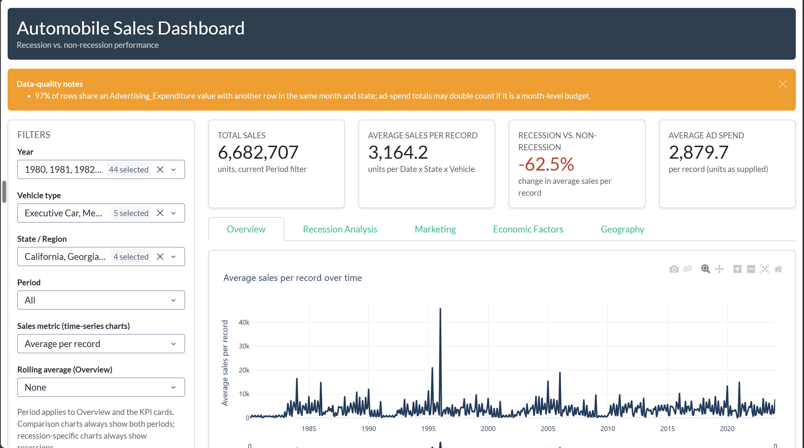
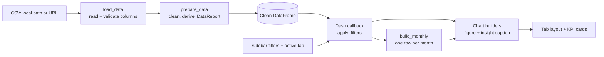

# Automobile Sales Performance Across Economic Cycles

**An interactive Plotly Dash dashboard that compares automobile sales in recession and non-recession periods, and links them to advertising, seasonality and macroeconomic drivers.**


-563D7C?logo=bootstrap&logoColor=white)

## Dashboard Preview



---

## Table of Contents

1. [Project Overview](#project-overview)
2. [Key Findings](#key-findings)
3. [Business Questions](#business-questions)
4. [Dataset](#dataset)
5. [Methodology](#methodology)
6. [Dashboard Walkthrough](#dashboard-walkthrough)
7. [Data Quality and Validation](#data-quality-and-validation)
8. [Architecture](#architecture)
9. [Repository Structure](#repository-structure)
10. [Getting Started](#getting-started)
11. [Configuration](#configuration)
12. [Limitations](#limitations)
13. [Future Work](#future-work)
14. [Author](#author)

---

## Project Overview

Car sales are very sensitive to the business cycle. When the economy shrinks, households put off big purchases, and car makers must decide where to spend on marketing and which vehicle lines to protect.

This project turns 44 years of monthly sales data (**January 1980 to December 2023, 2,112 records**) into a dashboard that answers one main question:

> **How do automobile sales behave during recessions, and which economic and marketing factors move with them?**

The project has two deliverables:

| File | Purpose |
|---|---|
| `Dashboard_on_Automobile_Sales_Performance_across_Economic_Cycles.ipynb` | Notebook version. Downloads the dataset from a URL with `requests` and runs the dashboard inline in Jupyter. Good for exploring and reviewing. |
| `app.py` | Standalone production version. Reads a local CSV or URL with `pandas.read_csv`, is configured through environment variables, and runs as a normal Dash web server. |

Both files share the same analysis logic, chart builders and layout. The only difference is how they load the data.

---

## Key Findings

Results from the full dataset (all years, vehicle types and states):

| Metric | Value |
|---|---|
| Total units sold (1980–2023) | **6,682,707** |
| Average units per record | **3,164.2** |
| Recession vs. non-recession sales | **−62.5%** |
| Average advertising spend per record | **2,879.7** |

- **Recessions hit sales hard.** Average sales per record are **62.5% lower** during recessions than in non-recession periods.
- **Advertising data needs care.** About 97% of rows repeat an advertising value within the same month and state, so ad-spend totals may double count. The dashboard uses averages for fair comparisons.

---

## Business Questions

The dashboard is built around these questions:

1. How have sales changed over time, and where were the peaks and troughs?
2. How much lower (or higher) are sales during recessions?
3. Which vehicle types are most and least resilient in a downturn?
4. Does advertising spend relate to sales, and does that relationship change in recessions?
5. How do GDP, consumer confidence, unemployment, growth rate and competition relate to sales?
6. How strong is seasonality across the calendar year?
7. Which US states sell the most during recessions, and which vehicle type leads in each?

---

## Dataset

**Source:** Historical automobile sales dataset hosted by IBM Skills Network (`automobile-sales.csv`).

**Grain:** one row per **Date × State × Vehicle Type**. The panel is unbalanced, so some months have more rows than others.

| Column | Type | Description |
|---|---|---|
| `Date` | date | Month-end date of the record |
| `Year`, `Month` | int / text | Calendar year and month (re-derived from `Date` during cleaning) |
| `Recession` | 0 / 1 | 1 if the month is in a recession period |
| `Automobile_Sales` | numeric | Units sold |
| `Vehicle_Type` | text | e.g. `SmallFamilyCar`, `Sports`, `ExecutiveCar` |
| `City` | text | **Holds US state names** (see note below) |
| `Price` | numeric | Average vehicle price |
| `Advertising_Expenditure` | numeric | Advertising spend |
| `Seasonality_Weight` | numeric | Seasonal adjustment weight |
| `Consumer_Confidence` | numeric | Consumer confidence index (month-level) |
| `GDP` | numeric | Gross domestic product (month-level) |
| `Growth_Rate` | numeric | Economic growth rate (month-level) |
| `Unemployment_Rate` | numeric | Unemployment rate, % (month-level) |
| `Competition` | numeric | Competition level in the market (month-level) |

> **Note on `City`:** despite its name, this column contains US **state** names. The app maps them to two-letter USPS codes for the choropleth map instead of geocoding them. Geocoding would cause errors, such as "Georgia" resolving to the country instead of the state.

---

## Methodology

The analysis follows four modelling rules. Each one prevents a common error in this kind of data.

### 1. Compare averages, not totals, across regimes
Recession and non-recession periods cover very different numbers of months. Comparing **total** sales would mostly measure how long each period lasted. All recession vs. non-recession comparisons therefore use the **average sales per record**.

### 2. Analyse macro variables on a monthly frame
GDP, consumer confidence, unemployment, growth rate and competition are **month-level** values. They repeat on every row in that month. If they were analysed at row level, months with more rows would count more. The app builds a **one-row-per-month frame** (`build_monthly`) before any correlation, scatter plot or box plot of these variables.

### 3. Treat recession as a property of the month
If a single date has mixed `Recession` flags, the app uses the most common value for that date. This keeps each month in one regime only.

### 4. Trust `Date` over derived columns
`Year` and `Month` are re-derived from `Date`. Any disagreement is reported in the data-quality panel.

### Statistical methods
- **Pearson correlation (r)** on complete pairs, with a minimum of 3 points and a check that both variables vary. Each r is shown with its sample size (n).
- **OLS trendlines** on scatter plots (through `statsmodels`). If a trendline cannot be fitted, the chart still renders without it.
- **Rolling averages** (3, 6 or 12 months) to smooth the sales time series.
- **Percent change** between regimes: `(Recession − Non-Recession) / Non-Recession × 100`.

---

## Dashboard Walkthrough

The interface has a sticky **filter sidebar**, a **KPI row**, and **five tabs**. Every chart sits in a card with an automatic **"Insight"** caption. The caption is recalculated from the current filters, so the dashboard explains itself as the user explores.

### Filters

| Filter | Effect |
|---|---|
| Year | Multi-select of years |
| Vehicle type | Multi-select of vehicle types |
| State / Region | Multi-select of states |
| Period | All / Recession / Non-Recession (applies to the Overview tab and KPI cards) |
| Sales metric | Average per record or Total (time-series charts) |
| Rolling average | None / 3 / 6 / 12 months (Overview tab) |

Comparison charts always show **both** periods, and recession-specific charts always show **recession months**, whatever the Period filter is set to. This keeps comparisons valid.

### KPI cards

| KPI | Definition |
|---|---|
| Total sales | Sum of units for the current filters |
| Average sales per record | Mean units per Date × State × Vehicle record |
| Recession vs. non-recession | % change in average sales per record (red if negative, green if positive) |
| Average ad spend | Mean advertising expenditure per record |

### Tabs and charts

| Tab | Chart | What it shows |
|---|---|---|
| **Overview** | Sales over time | Monthly sales with optional rolling average and a range slider; caption gives the peak and low months |
| | Seasonality | Average sales by calendar month (bars) with `Seasonality_Weight` on a second axis (line) |
| **Recession Analysis** | Recession windows | Sales line with recession periods shaded and recession months marked |
| | Average sales by period | Recession vs. non-recession bar chart with % difference |
| | Vehicle type by period | Grouped bars per vehicle type; caption names the hardest-hit and most resilient types |
| **Marketing** | Ad spend vs. sales | Monthly scatter with OLS trendline, coloured by period, with r per period |
| | Ad spend by period | Average ad spend per record in each regime |
| | Recession ad spend by vehicle | Donut chart of each vehicle type's share of recession ad spend |
| **Economic Factors** | GDP variation | Box plot by period plus GDP trend over time |
| | Consumer confidence vs. sales | Recession months only, with OLS trendline and r |
| | Unemployment vs. sales | Bubble chart by vehicle type (bubble size = price), with r per vehicle type |
| | Correlation heatmap | Pearson matrix of all drivers on the monthly frame |
| | Growth rate vs. sales | Scatter by period, showing whether sales react to growth differently in recessions |
| | Competition level | Box plot of monthly sales by competition level and period |
| **Geography** | State choropleth | Total recession-period sales by state, with top vehicle type and average ad spend on hover |
| | Top 5 states | Horizontal bar chart of the leading states during recessions |

The **correlation heatmap**, **growth rate** and **competition** charts go beyond the core brief. They were added because these drivers are in the dataset but were not covered by the other charts. Each has a short justification in its docstring.

---

## Data Quality and Validation

`prepare_data()` cleans and checks the data before any chart is drawn. Every issue it finds is logged and shown in a dismissable **"Data-quality notes"** panel at the top of the dashboard.

| Check | Action |
|---|---|
| Required columns missing | App stops with a clear error listing the missing columns |
| Column names in a different case or with spaces | Mapped to the standard names |
| Missing `Date`, `Recession` or `Automobile_Sales` | Rows dropped and counted |
| `Recession` not 0 or 1 | Rows dropped and counted |
| Negative sales | Rows dropped and counted |
| Fully duplicated rows | Removed |
| Repeated Date + State + Vehicle key | Kept, but reported |
| `Year` or `Month` disagrees with `Date` | Re-derived from `Date` |
| Mixed `Recession` flags within a date | Mode used |
| State names that cannot be mapped | Excluded from the map only |
| Macro variables not constant within a month | Monthly means used, and reported |
| Repeated advertising values within a month and state | Reported as a double-counting risk |

**Finding from the full dataset:** about **97% of rows share an `Advertising_Expenditure` value** with another row in the same month and state. This suggests advertising may be recorded as a month-level budget, not per vehicle type. The app therefore uses **averages** for advertising comparisons and adds a caution to the ad-spend **totals** in the donut chart.

---

## Architecture



Key design choices in `app.py`:

- **One callback** drives the KPI row and the active tab. Only the visible tab's charts are built, which keeps the app responsive.
- **Chart builders are pure functions.** Each takes a DataFrame and returns `(figure, caption)`, so each one can be tested on its own.
- **Empty selections are handled.** Every chart returns a friendly "No data for this selection" placeholder instead of an error.
- **All settings are named constants** (colours, heights, thresholds, palette) at the top of the file, so the look can be changed in one place.
- **Accessible colours.** Recession is red and non-recession is blue throughout, and vehicle types use Plotly's colour-blind-safe `Safe` palette.
- **`lru_cache`** on data loading avoids re-reading the CSV.

---

## Repository Structure

```text
.
.
├── app.py                         # Standalone Dash application
├── Dashboard_on_Automobile_Sales_Performance_across_Economic_Cycles.ipynb
├── requirements.txt               # Python packages needed to run the app
├── overview.png                   # Dashboard screenshots
├── overview2.png
├── recession.png
├── recession2.png
├── economic.png
├── economic2.png
├── economic3.png
├── map.png
└── README.md
```

---

## Getting Started

### 1. Clone the repository

```bash
git clone https://github.com/GregoryOnokwai/<repository-name>.git
cd <repository-name>
```

### 2. Create an environment and install dependencies

```bash
python -m venv .venv
source .venv/bin/activate        # Windows: .venv\Scripts\activate
pip install -r requirements.txt
```

`requirements.txt`:

```text
dash>=2.9
dash-bootstrap-components>=1.4
pandas>=1.5
numpy>=1.23
plotly>=5.13
statsmodels>=0.13   # OLS trendlines (optional; charts still render without it)
requests>=2.28      # notebook only
```

### 3. Run the app

```bash
# Uses historical_automobile_sales.csv in the project folder
python app.py

# Or point to another file or URL
DATA_PATH=/path/to/automobile-sales.csv python app.py
```

Then open **http://127.0.0.1:8050** in your browser.

### 4. Or run the notebook

Open the `.ipynb` file in Jupyter and run all cells. It downloads the dataset automatically and displays the dashboard inline.

---

## Configuration

| Variable | Default | Description |
|---|---|---|
| `DATA_PATH` | `historical_automobile_sales.csv` | Local CSV path or URL |
| `HOST` | `127.0.0.1` | Server host (use `0.0.0.0` for Docker or cloud hosting) |
| `PORT` | `8050` | Server port |
| `DASH_DEBUG` | `0` | Set to `1` to enable Dash debug mode and hot reload |

---

## Limitations

- **Correlation is not causation.** The r values describe linear links in this dataset only. They do not show that one factor causes another.
- **Small samples in recession charts.** Recession months are a small share of the 44-year period, so recession-only correlations can rest on few points. Each r is shown with its n for this reason.
- **Advertising totals may double count**, as explained in [Data Quality and Validation](#data-quality-and-validation).
- **Units are as supplied.** Prices and advertising values are not adjusted for inflation.
- **Recession flags come from the dataset.** They are not checked against official sources such as NBER business-cycle dates.

---

## Future Work

- Adjust prices and ad spend for inflation using CPI.
- Add lagged correlations (for example, does unemployment lead sales by 3 to 6 months?).
- Add a simple forecasting view (SARIMA or Prophet) with recession scenarios.
- Add unit tests for `prepare_data` and the chart builders with `pytest`.
- Deploy to Render, Railway or Hugging Face Spaces, and add a live demo link here.
- Add a Dockerfile for one-command setup.

---

## Author

**Gregory Onokwai**: Data Analyst and STEM Instructor, Calgary, Alberta

- Portfolio: [gregoryonokwai.tech](https://gregoryonokwai.tech)
- LinkedIn: [linkedin.com/in/gregory-onokwai](https://www.linkedin.com/in/gregory-onokwai)
- GitHub: [@GregoryOnokwai](https://github.com/GregoryOnokwai)

---

*If you find this project useful, please consider giving it a star.*
